# Scitizia: 57 árvores, pedras, construções de sítio, vilarejo e montanha, pontes e pórticos low poly em glTF/GLB com visual retrô de 64 bits

![Mosaico com os 57 modelos low poly de natureza e beira de estrada: pinheiros, árvores folhosas, ipê amarelo, palmeira, bananeira, cacto, arbustos, capim, juncos, pedras, casinhas de sítio, celeiro, caixa-d'água, porteira, poste de madeira, placas de advertência, silos, cata-vento, cabana de campo, pórticos de largada e chegada, pontes de concreto, de madeira e de pedra, barragem, muro de contenção, armazém e bar de fachada falsa, casa e celeiro velhos, torre d'água de madeira, cabanas de montanha, abrigos de pedra, ruína de pedra, cabana de palha e posto avançado](docs/natureza-low-poly-64-bits.jpg)

**Scitizia: natureza 64 bits** é uma coleção gratuita de natureza e beira de estrada em baixo polígono (low poly), com o visual retrô dos consoles de 64 bits, pronta para jogos de corrida e de mundo aberto em tempo real: **11 árvores** (pinheiros, folhosas, ipê, palmeira, bananeira, cacto, árvore seca), **10 arbustos, touceiras de capim, juncos e pedras** (também com neve), **12 construções de sítio e de beira de estrada** (casinhas, celeiro, caixa-d'água, porteira, poste, placas de ponte e de vau, silo e par de silos, cata-vento de fazenda e cabana de campo), **7 peças de estrada** (pórticos de largada e chegada, pontes de concreto, de madeira e de pedra em arco, a barragem de uma represa e um muro de contenção de pedra), **5 peças de túnel e ferrovia** (boca de túnel na rocha, módulos de trilho com dormentes de madeira e de concreto, sinal de passagem de nível com cruz de santo andré e poste de telégrafo) e **12 construções de vilarejo, montanha e mata** (armazém e bar de madeira de fachada falsa, casa e celeiro de tábuas desbotadas, torre d'água de madeira, cabanas de montanha com e sem neve, abrigos de pedra, ruína de pedra com musgo, cabana de palha e posto avançado sobre palafitas). São 57 arquivos glTF 2.0 binários (`.glb`) de 3,1 a 608,1 KB, com 12 a 4.650 triângulos (a maioria abaixo de 200, feitos para milhares de cópias instanciadas), cor por vértice com sombreado assado e texturas de 64×64 px. Os modelos são os mesmos do mundo aberto e dos estágios do jogo **Scitizia Rally Championship**, montados pelo próprio código do jogo.

**English summary:** Scitizia 64-bit nature is a free pack of 57 low-poly nature and roadside models with a retro 64-bit console look: 11 trees (pines, broadleaf trees, a yellow flowering tree, palm, banana plant, cactus, dead tree), 10 bushes, grass tufts, reeds and rocks (some with snow), 12 farm and roadside models (small farmhouses, barn, water tower, farm gate, wooden utility pole, narrow bridge and water crossing warning signs, grain silos, farm windmill and a country cabin), 7 road pieces (start and finish gantries, concrete, wooden and stone arch bridges, a dam and a stone retaining wall), 5 tunnel and railway pieces (a rock tunnel portal, railway track modules with wooden and concrete sleepers, a level crossing signal and a telegraph pole) and 12 village, mountain and jungle buildings (abandoned false-front general store and two-storey wooden bar, old wooden house and weathered barn, wooden water tower, mountain cabins with and without snow, stone shelters, mossy stone ruin, thatched hut and a stilt lookout post). Every model is a binary glTF 2.0 (`.glb`) file with 12 to 4650 triangles (most under 200, made for thousands of instanced copies), vertex colors with baked shading and small 64×64 textures. Units are meters, Y is up, the front faces +Z and the origin sits on the ground. Public domain (CC0 1.0).

## Resumo

| | |
|---|---|
| Modelos | 57: árvores (11) · arbustos, capim e pedras (10) · sítio e beira de estrada (12) · estrada, pontes e represa (7) · vilarejo, montanha e mata (12) · túnel e ferrovia (5) |
| Formato | glTF 2.0 binário (`.glb`), texturas também em PNG |
| Triângulos | 12 a 4.650 por modelo (média 747) |
| Tamanho | 3,1 a 608,1 KB por arquivo, com as texturas embutidas |
| Materiais | cor por vértice com sombreado assado; 8 texturas de 64×64 px em tons de cinza (lona, metal, madeira...) e as placas com texto |
| Escala e eixos | metros, Y para cima, frente em +Z, origem no chão |
| Catálogo legível por máquina | [`catalogo.json`](catalogo.json) |
| Licença | domínio público, [CC0 1.0](LICENSE) |

## Árvores

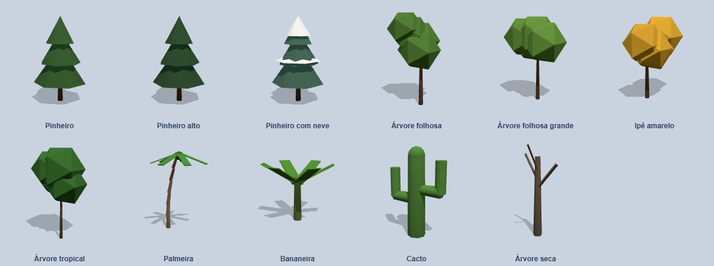

Árvores de poucas dezenas a poucas centenas de triângulos, para florestas instanciadas: a copa é de poliedros facetados e a cor varia por peça.

| Prévia | Modelo | Descrição | Triângulos | Medidas | Tamanho |
|---|---|---|---|---|---|
| 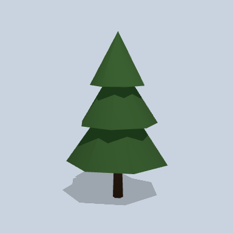 | **Pinheiro**<br>[`pinheiro.glb`](modelos/pinheiro.glb) | Pinheiro de 11 m em cones empilhados | 66 | 6,4 m × 10,6 m × 6,3 m | 10,0 KB |
| 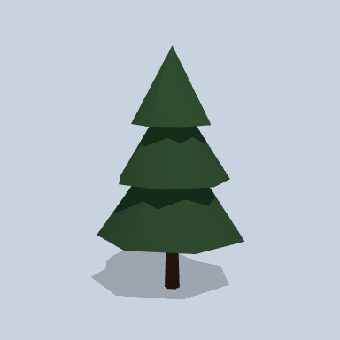 | **Pinheiro alto**<br>[`pinheiro_alto.glb`](modelos/pinheiro_alto.glb) | Pinheiro escuro de 14 m | 66 | 8,2 m × 13,4 m × 8,0 m | 10,0 KB |
|  | **Pinheiro com neve**<br>[`pinheiro_com_neve.glb`](modelos/pinheiro_com_neve.glb) | Pinheiro com neve nas pontas dos galhos | 94 | 5,9 m × 9,7 m × 5,7 m | 13,6 KB |
|  | **Árvore folhosa**<br>[`arvore_folhosa.glb`](modelos/arvore_folhosa.glb) | Árvore de copa redonda de 8 m | 104 | 4,1 m × 8,1 m × 4,1 m | 14,9 KB |
| 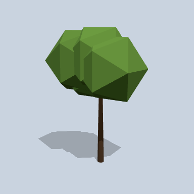 | **Árvore folhosa grande**<br>[`arvore_folhosa_grande.glb`](modelos/arvore_folhosa_grande.glb) | Árvore de copa larga de 9 m | 104 | 6,1 m × 8,4 m × 4,3 m | 14,9 KB |
|  | **Ipê amarelo**<br>[`ipe_amarelo.glb`](modelos/ipe_amarelo.glb) | Árvore florida de copa amarela | 104 | 3,5 m × 7,3 m × 5,6 m | 14,9 KB |
| 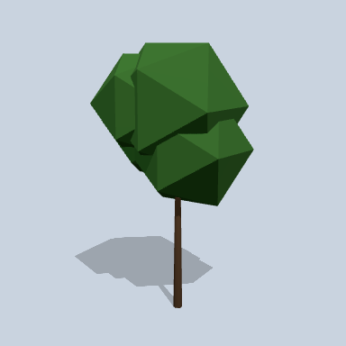 | **Árvore tropical**<br>[`arvore_tropical.glb`](modelos/arvore_tropical.glb) | Árvore alta de copa verde-escura, 12 m | 104 | 6,9 m × 11,8 m × 6,5 m | 14,9 KB |
| 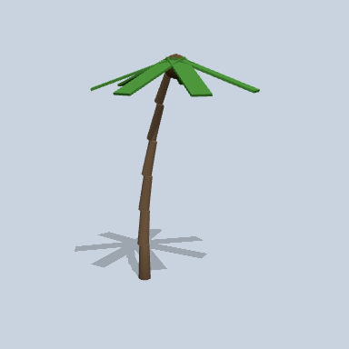 | **Palmeira**<br>[`palmeira_de_praia.glb`](modelos/palmeira_de_praia.glb) | Palmeira de tronco em gomos e leque de folhas | 308 | 6,0 m × 8,7 m × 5,9 m | 41,2 KB |
|  | **Bananeira**<br>[`bananeira.glb`](modelos/bananeira.glb) | Bananeira de seis folhas | 96 | 3,9 m × 3,4 m × 4,1 m | 13,8 KB |
|  | **Cacto**<br>[`cacto.glb`](modelos/cacto.glb) | Cacto de braços (deserto) | 208 | 2,4 m × 3,5 m × 72 cm | 28,2 KB |
| 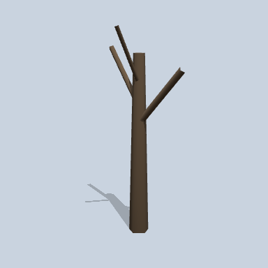 | **Árvore seca**<br>[`arvore_seca.glb`](modelos/arvore_seca.glb) | Tronco seco com galhos sem folhas | 44 | 2,5 m × 4,8 m × 1,6 m | 7,2 KB |

## Arbustos, capim e pedras


O miúdo da beira de estrada e da beira d'água. O capim tem 12 triângulos: dá para espalhar aos milhares.

| Prévia | Modelo | Descrição | Triângulos | Medidas | Tamanho |
|---|---|---|---|---|---|
|  | **Arbusto verde**<br>[`arbusto_verde.glb`](modelos/arbusto_verde.glb) | Moita arredondada | 40 | 1,9 m × 1,2 m × 1,5 m | 6,7 KB |
|  | **Arbusto escuro**<br>[`arbusto_escuro.glb`](modelos/arbusto_escuro.glb) | Moita verde-escura | 40 | 1,9 m × 1,2 m × 1,5 m | 6,7 KB |
|  | **Arbusto seco**<br>[`arbusto_seco.glb`](modelos/arbusto_seco.glb) | Moita seca de cerrado e deserto | 40 | 1,9 m × 1,2 m × 1,5 m | 6,7 KB |
|  | **Arbusto com neve**<br>[`arbusto_com_neve.glb`](modelos/arbusto_com_neve.glb) | Moita com neve por cima | 60 | 1,9 m × 1,2 m × 1,5 m | 9,3 KB |
|  | **Capim verde**<br>[`capim_verde.glb`](modelos/capim_verde.glb) | Touceira de capim (12 triângulos) | 12 | 39 cm × 1,1 m × 55 cm | 3,1 KB |
| 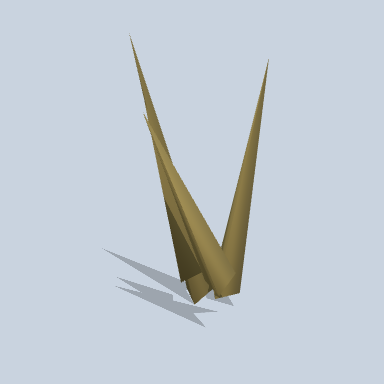 | **Capim seco**<br>[`capim_seco.glb`](modelos/capim_seco.glb) | Touceira de capim seco | 12 | 39 cm × 1,1 m × 55 cm | 3,1 KB |
| 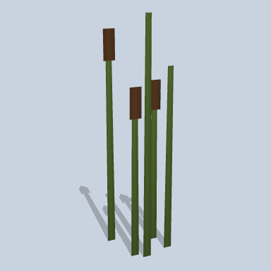 | **Junco**<br>[`junco.glb`](modelos/junco.glb) | Juncos de beira d'água com as espigas | 48 | 48 cm × 1,7 m × 36 cm | 7,7 KB |
|  | **Pedra**<br>[`pedra.glb`](modelos/pedra.glb) | Pedra achatada | 20 | 1,8 m × 95 cm × 1,4 m | 4,1 KB |
|  | **Pedra grande**<br>[`pedra_grande.glb`](modelos/pedra_grande.glb) | Duas rochas grandes juntas | 40 | 4,6 m × 2,7 m × 3,7 m | 6,7 KB |
|  | **Pedra com neve**<br>[`pedra_com_neve.glb`](modelos/pedra_com_neve.glb) | Pedra com neve por cima | 40 | 1,8 m × 96 cm × 1,4 m | 6,7 KB |

## Sítio e beira de estrada

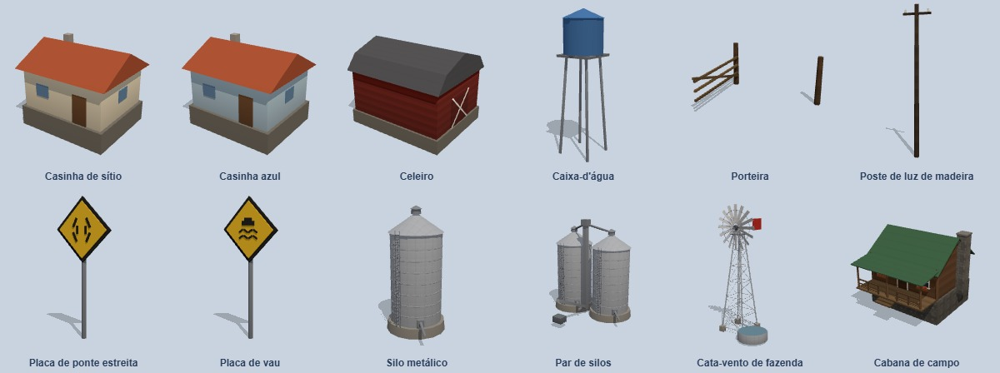

As construções dos sítios do mundo aberto e as placas que avisam das pontes estreitas e dos vaus. As casinhas, o celeiro e a cabana de campo têm uma fundação de pedra que desce abaixo do chão, para assentar em terreno irregular. As pás do cata-vento são uma malha à parte, para girar em volta do eixo Z que passa pelo cubo (y = 10,6 m, z = 0,6 m).

| Prévia | Modelo | Descrição | Triângulos | Medidas | Tamanho |
|---|---|---|---|---|---|
|  | **Casinha de sítio**<br>[`casinha_de_sitio.glb`](modelos/casinha_de_sitio.glb) | Casa de sítio com telhado de duas águas e chaminé | 92 | 6,8 m × 5,8 m × 5,8 m | 13,3 KB |
| 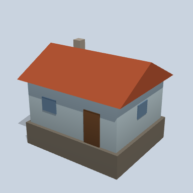 | **Casinha azul**<br>[`casinha_azul.glb`](modelos/casinha_azul.glb) | A mesma casinha em azul | 92 | 6,8 m × 5,8 m × 5,8 m | 13,3 KB |
| 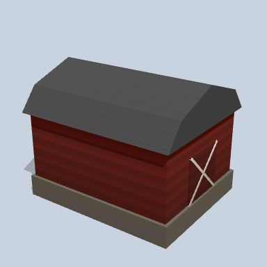 | **Celeiro**<br>[`celeiro.glb`](modelos/celeiro.glb) | Celeiro vermelho de madeira com telhado de chapa | 112 | 10,6 m × 8,4 m × 8,8 m | 21,6 KB |
|  | **Caixa-d'água**<br>[`caixa_dagua.glb`](modelos/caixa_dagua.glb) | Caixa-d'água azul sobre torre de quatro pés | 112 | 2,6 m × 9,4 m × 2,8 m | 15,9 KB |
|  | **Porteira**<br>[`porteira.glb`](modelos/porteira.glb) | Porteira de madeira aberta entre dois mourões | 96 | 4,8 m × 2,2 m × 4,2 m | 16,7 KB |
| 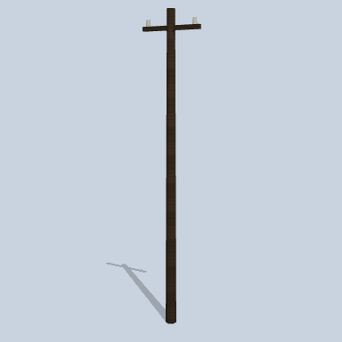 | **Poste de luz de madeira**<br>[`poste_de_madeira.glb`](modelos/poste_de_madeira.glb) | Poste rural com cruzeta e isoladores | 96 | 1,8 m × 8,6 m × 30 cm | 17,9 KB |
|  | **Placa de ponte estreita**<br>[`placa_ponte_estreita.glb`](modelos/placa_ponte_estreita.glb) | Placa de advertência em losango: ponte estreita | 120 | 1,3 m × 2,9 m × 14 cm | 16,9 KB |
| 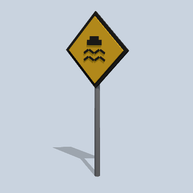 | **Placa de vau**<br>[`placa_vau.glb`](modelos/placa_vau.glb) | Placa de advertência em losango: pista alagada (vau) | 168 | 1,3 m × 2,9 m × 14 cm | 23,1 KB |
| 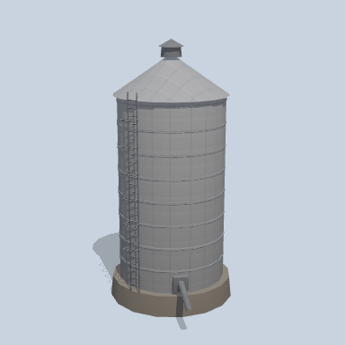 | **Silo metálico**<br>[`silo.glb`](modelos/silo.glb) | Silo de chapa galvanizada com cintas, teto cônico, respiro, escada com gaiola e bica de descarga | 1.200 | 6,7 m × 12,6 m × 6,7 m | 158,2 KB |
| 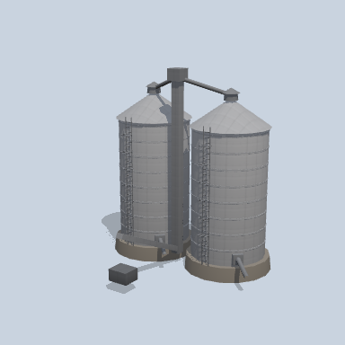 | **Par de silos**<br>[`silo_par.glb`](modelos/silo_par.glb) | Dois silos com o elevador de grãos no meio e a esteira inclinada | 2.482 | 13,1 m × 13,8 m × 11,3 m | 323,4 KB |
| 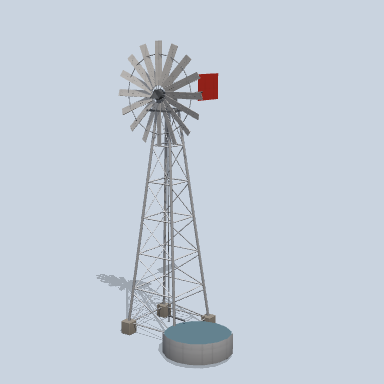 | **Cata-vento de fazenda**<br>[`moinho_de_vento.glb`](modelos/moinho_de_vento.glb) | Cata-vento de bomba d'água em torre treliçada, 16 pás, leme e bebedouro redondo | 1.712 | 6,3 m × 13,0 m × 6,8 m | 229,6 KB |
| 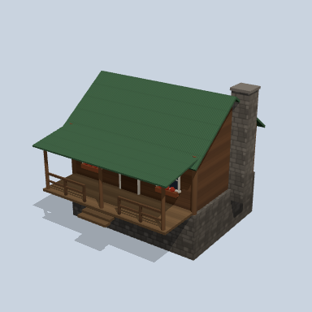 | **Cabana de campo**<br>[`cabana_de_campo.glb`](modelos/cabana_de_campo.glb) | Cabana de madeira com varanda coberta, telhado de chapa verde, chaminé de pedra e lenha | 2.310 | 8,2 m × 7,2 m × 9,0 m | 308,3 KB |

## Estrada, pontes e represa

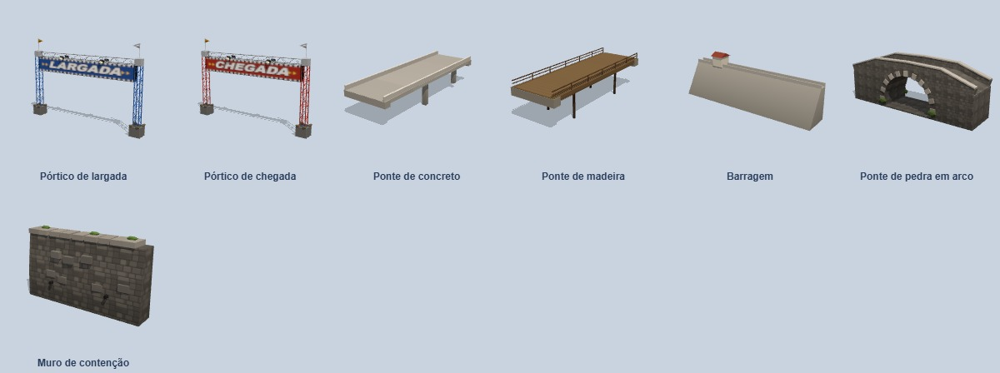

Pórticos de largada e chegada dos estágios (a estrada passa entre as torres, em Z), pontes desenhadas sobre uma estrada reta (o piso da pista não vem junto: o tabuleiro fica 3 cm abaixo dela, com a origem na altura da pista e os pilares descendo até o leito do rio), a barragem de concreto com a casa de controle, a ponte de pedra em arco (vão em X, para valas e riachos estreitos) e o módulo de 6 m do muro de contenção (no jogo vai em fileira no pé dos barrancos, esticado na altura).

| Prévia | Modelo | Descrição | Triângulos | Medidas | Tamanho |
|---|---|---|---|---|---|
|  | **Pórtico de largada**<br>[`portico_de_largada.glb`](modelos/portico_de_largada.glb) | Pórtico de treliça azul com faixa LARGADA, refletores e bandeirinhas (estrada de 10,4 m) | 3.060 | 11,5 m × 7,3 m × 1,1 m | 425,6 KB |
| 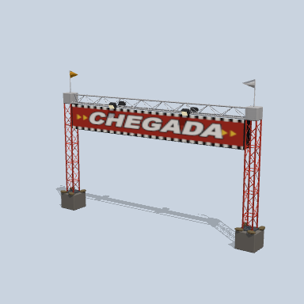 | **Pórtico de chegada**<br>[`portico_de_chegada.glb`](modelos/portico_de_chegada.glb) | Pórtico de treliça vermelho com faixa CHEGADA | 3.060 | 11,5 m × 7,3 m × 1,1 m | 426,6 KB |
| 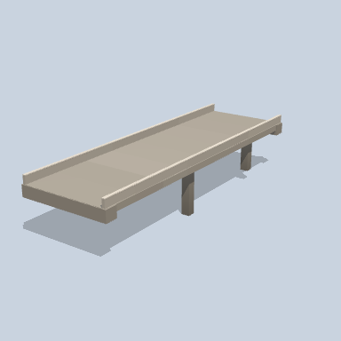 | **Ponte de concreto**<br>[`ponte_de_concreto.glb`](modelos/ponte_de_concreto.glb) | Ponte de 28 m: tabuleiro, muretas, pilares e cabeceiras (pista de 8,4 m) | 552 | 10,0 m × 6,7 m × 32,2 m | 72,6 KB |
| 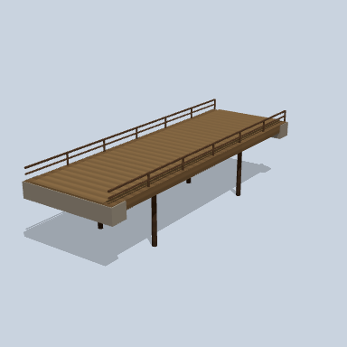 | **Ponte de madeira**<br>[`ponte_de_madeira.glb`](modelos/ponte_de_madeira.glb) | Ponte de 20 m: tábuas, guarda-corpo de madeira, pilares roliços (pista de 6,4 m) | 792 | 8,0 m × 6,5 m × 24,2 m | 107,5 KB |
| 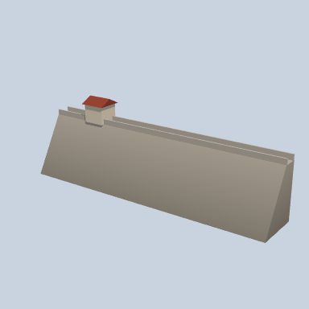 | **Barragem**<br>[`barragem.glb`](modelos/barragem.glb) | Barragem de concreto de 36 m com mureta e casa de controle | 56 | 36,0 m × 11,5 m × 7,3 m | 8,5 KB |
| 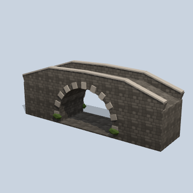 | **Ponte de pedra em arco**<br>[`ponte_de_pedra.glb`](modelos/ponte_de_pedra.glb) | Pontilhão de pedra de 13 m com um arco de 5 m, aduelas, parapeitos e musgo | 732 | 13,2 m × 4,7 m × 3,6 m | 99,1 KB |
| 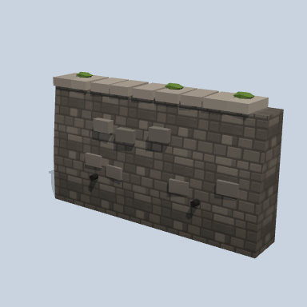 | **Muro de contenção**<br>[`muro_de_contencao.glb`](modelos/muro_de_contencao.glb) | Módulo de 6 m de muro de pedra empilhada para barrancos, com pedras de capa e drenos | 352 | 6,0 m × 3,4 m × 1,2 m | 50,1 KB |

## Vilarejo, montanha e mata

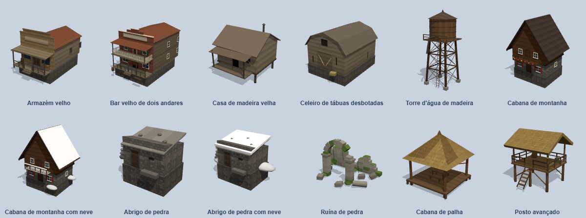

Construções dos estágios e do mundo aberto por bioma: o vilarejo abandonado de madeira do deserto, as cabanas e abrigos das serras e da tundra e as ruínas e coberturas de palha da mata tropical. As que assentam em terreno irregular têm uma fundação de pedra que desce 1,9 m abaixo do chão; as placas das fachadas vêm em branco.

| Prévia | Modelo | Descrição | Triângulos | Medidas | Tamanho |
|---|---|---|---|---|---|
| 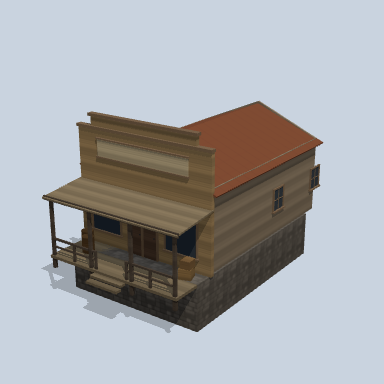 | **Armazém velho**<br>[`armazem_velho.glb`](modelos/armazem_velho.glb) | Armazém abandonado de madeira com fachada falsa alta, vitrines, placa em branco e varanda coberta | 1.684 | 8,0 m × 8,8 m × 13,8 m | 227,6 KB |
| 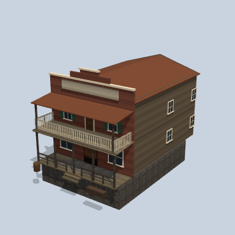 | **Bar velho de dois andares**<br>[`saloon_velho.glb`](modelos/saloon_velho.glb) | Bar de madeira de dois andares com fachada em degraus, portas de vaivém, varanda e sacada com balaústres | 3.560 | 9,7 m × 11,4 m × 16,1 m | 469,3 KB |
| 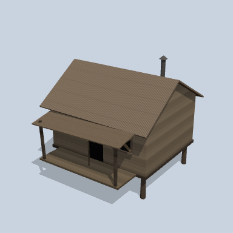 | **Casa de madeira velha**<br>[`casa_de_madeira_velha.glb`](modelos/casa_de_madeira_velha.glb) | Casinha de tábuas sobre toquinhos, telhado caído, janelas tapadas e porta entreaberta | 676 | 6,6 m × 6,5 m × 7,2 m | 96,5 KB |
| 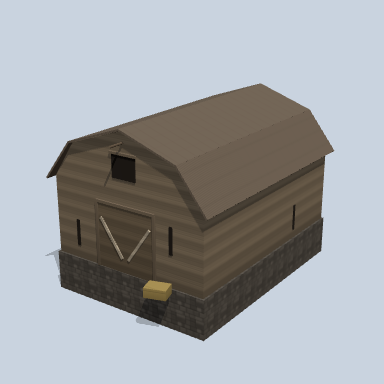 | **Celeiro de tábuas desbotadas**<br>[`celeiro_seco.glb`](modelos/celeiro_seco.glb) | Celeiro de telhado de duas inclinações, portão com X, porta do palheiro e frestas | 1.054 | 9,8 m × 9,4 m × 13,8 m | 149,8 KB |
| 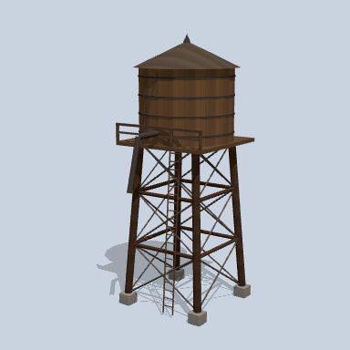 | **Torre d'água de madeira**<br>[`torre_dagua_madeira.glb`](modelos/torre_dagua_madeira.glb) | Tanque de aduelas com cintas de ferro sobre torre de pernas contraventadas, bica e escada | 1.486 | 4,7 m × 12,1 m × 6,5 m | 199,1 KB |
| 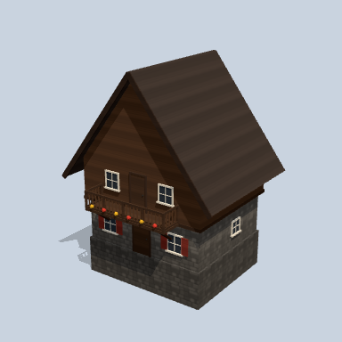 | **Cabana de montanha**<br>[`cabana_alpina.glb`](modelos/cabana_alpina.glb) | Cabana de pedra e madeira de telhado íngreme, sacada na empena, venezianas, chaminé e lenha | 4.202 | 9,5 m × 11,8 m × 8,4 m | 550,3 KB |
| 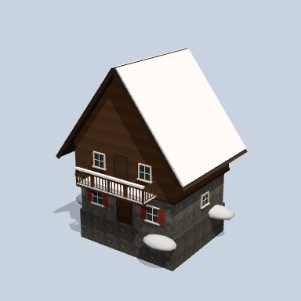 | **Cabana de montanha com neve**<br>[`cabana_alpina_neve.glb`](modelos/cabana_alpina_neve.glb) | A mesma cabana com neve no telhado, na sacada e montes no pé das paredes | 4.650 | 10,2 m × 11,8 m × 8,9 m | 608,1 KB |
| 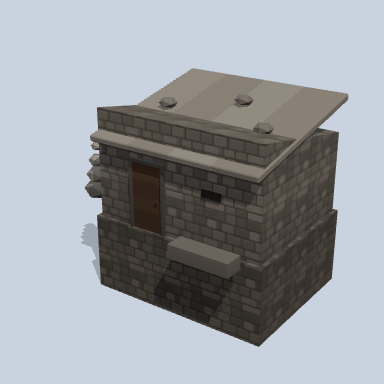 | **Abrigo de pedra**<br>[`abrigo_de_pedra.glb`](modelos/abrigo_de_pedra.glb) | Abrigo de paredes grossas, telhado de lajes, porta baixa, banco e marco de pedras | 784 | 6,1 m × 5,0 m × 4,8 m | 109,7 KB |
| 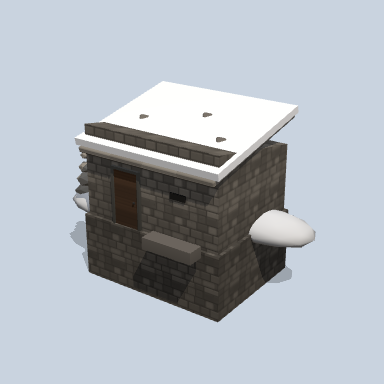 | **Abrigo de pedra com neve**<br>[`abrigo_de_pedra_neve.glb`](modelos/abrigo_de_pedra_neve.glb) | O mesmo abrigo coberto de neve | 1.068 | 7,7 m × 5,2 m × 5,6 m | 146,4 KB |
| 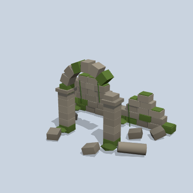 | **Ruína de pedra**<br>[`ruina_de_pedra.glb`](modelos/ruina_de_pedra.glb) | Muro quebrado de blocos com musgo, arco antigo de aduelas, blocos caídos e cipós | 1.024 | 8,5 m × 5,1 m × 5,8 m | 133,4 KB |
| 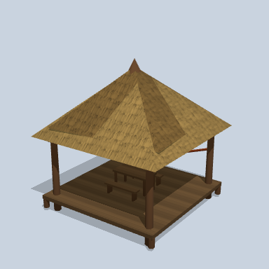 | **Cabana de palha**<br>[`cabana_de_palha.glb`](modelos/cabana_de_palha.glb) | Cobertura aberta de quatro águas em palha sobre esteios roliços, piso de tábuas, mesa, bancos e rede | 480 | 5,6 m × 6,0 m × 5,6 m | 77,8 KB |
| 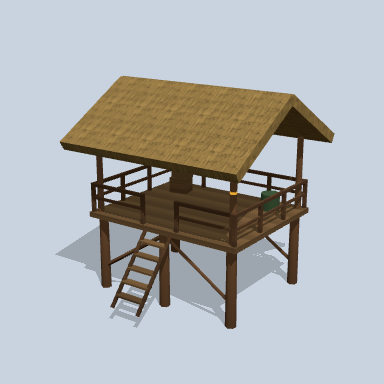 | **Posto avançado**<br>[`posto_avancado.glb`](modelos/posto_avancado.glb) | Plataforma de madeira sobre palafitas com escada, guarda-corpo, telhado de palha, caixotes e lampião | 922 | 6,0 m × 6,3 m × 6,4 m | 135,2 KB |

## Túnel e ferrovia

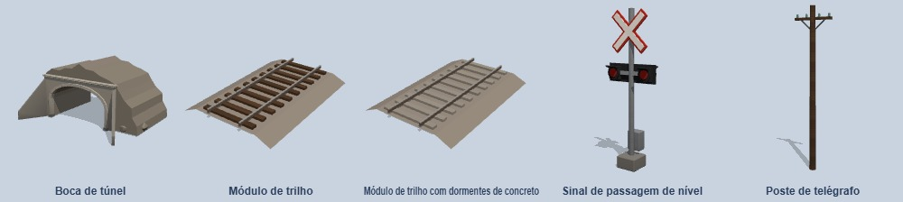

A boca do túnel na rocha dos estágios de montanha (a estrada entra em +Z pelo vão de 12 m) e a passagem de nível: módulos de linha reta de 6,2 m para emendar (lastro, dormentes e trilhos com bitola de 1,6 m), o sinal com a cruz de santo andré e as lanternas dos dois lados, e o poste de telégrafo que acompanha a linha.

| Prévia | Modelo | Descrição | Triângulos | Medidas | Tamanho |
|---|---|---|---|---|---|
| 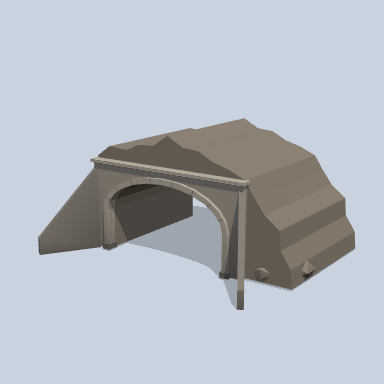 | **Boca de túnel**<br>[`boca_de_tunel.glb`](modelos/boca_de_tunel.glb) | Boca de concreto com aduelas, cornija e muros de ala num bloco de rocha furado, com 12 m de galeria (vão de 12 m por 6,3 m) | 860 | 24,3 m × 10,9 m × 17,2 m | 112,3 KB |
| 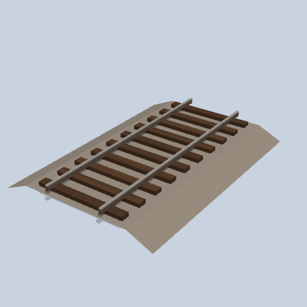 | **Módulo de trilho**<br>[`modulo_de_trilho.glb`](modelos/modulo_de_trilho.glb) | 6,2 m de linha reta para emendar: lastro de brita, dormentes de madeira e dois trilhos (bitola de 1,6 m) | 174 | 4,4 m × 58 cm × 6,2 m | 29,9 KB |
| 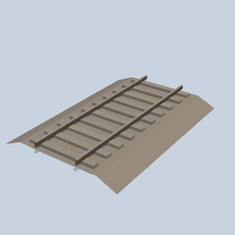 | **Módulo de trilho com dormentes de concreto**<br>[`modulo_de_trilho_concreto.glb`](modelos/modulo_de_trilho_concreto.glb) | O mesmo módulo de 6,2 m com dormentes de concreto | 174 | 4,4 m × 58 cm × 6,2 m | 26,0 KB |
| 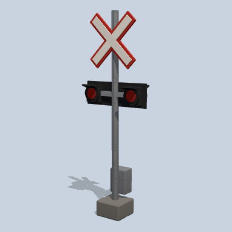 | **Sinal de passagem de nível**<br>[`sinal_passagem_de_nivel.glb`](modelos/sinal_passagem_de_nivel.glb) | Poste com cruz de santo andré, duas lanternas vermelhas de cada lado, caixa de comando e base de concreto | 768 | 1,5 m × 4,3 m × 66 cm | 102,5 KB |
| 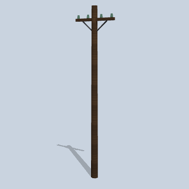 | **Poste de telégrafo**<br>[`poste_de_telegrafo.glb`](modelos/poste_de_telegrafo.glb) | Poste de madeira de 6,6 m com cruzeta, mãos-francesas e quatro isoladores | 152 | 1,7 m × 6,6 m × 27 cm | 25,1 KB |

## Pastas

- `modelos/<id>.glb`: um modelo por arquivo.
- `texturas/`: as 8 texturas de 64×64 px do kit (as mesmas que vão dentro dos `.glb`; as placas com texto ficam só dentro dos modelos).
- `previas/<id>.png`: vista três-quartos de cada modelo.
- `catalogo.json`: seções, modelos, descrições, medidas, triângulos, materiais e caminhos dos arquivos.
- `docs/`: mosaico geral, mosaicos por seção e a capa.

## Como usar os modelos

- Metros, eixo Y para cima, frente em +Z. A origem fica no chão, no pé da árvore, no centro da construção ou no eixo da estrada (pórticos e pontes).
- As cores estão na cor por vértice (com a base escurecida perto do chão, como luz ambiente assada); as texturas são cinza e só dão o grão. Ligue a cor por vértice no material se o seu programa não ligar sozinho.
- Para florestas grandes, desenhe cada modelo com instâncias (uma chamada de desenho por modelo) e varie giro e escala (0,8 a 1,3) por cópia.
- Os pórticos têm a faixa com texto em português (LARGADA e CHEGADA) no material `placa`: troque a textura para traduzir.

Exemplo em JavaScript, com o carregador de glTF da sua biblioteca web 3D:

```js
const pinheiro = (await carregadorGltf.loadAsync("modelos/pinheiro.glb")).scene;
pinheiro.traverse((o) => { if (o.isMesh) o.material.vertexColors = true; });
for (let i = 0; i < 200; i++) {
  const p = pinheiro.clone();
  p.position.set(Math.random() * 400 - 200, 0, Math.random() * 400 - 200);
  p.rotation.y = Math.random() * Math.PI * 2;
  cena.add(p);
}
```

## Perguntas frequentes

**Em que formato estão os modelos?**
Em glTF 2.0 binário (`.glb`), um arquivo por modelo, com malha, materiais e texturas embutidos. As texturas do kit também estão soltas em PNG.

**Posso importar em qualquer motor de jogo ou programa 3D?**
Sim, em qualquer motor, biblioteca web ou editor 3D que leia glTF 2.0. A única extensão usada é a de material sem iluminação (luzes e placas), que todos os leitores de glTF conhecem.

**As pontes vêm com a estrada?**
Não: só o tabuleiro, os guarda-corpos, os pilares e as cabeceiras. No jogo a pista passa por cima, como uma fita; ponha a sua estrada na altura y = 0 do modelo.

**Posso usar num jogo comercial?**
Sim. Os modelos estão em domínio público (CC0 1.0): use, modifique e redistribua sem pedir licença nem dar crédito. O crédito é bem-vindo (veja [`CITATION.cff`](CITATION.cff)).

**Como foram feitos?**
Por código: cada modelo é montado a partir de poliedros, cilindros, cones, caixas e perfis extrudados, com cor por vértice e texturas de 64 px desenhadas em canvas, pelo mesmo código que desenha o mundo aberto e os estágios no jogo. Cada arquivo foi exportado, aberto de novo e desenhado para conferir.

## Outras coleções do mesmo jogo

- [Frota de carros de rali](https://github.com/kayquer/scitizia-frota-64) · [Props quebráveis](https://github.com/kayquer/scitizia-props-64) · [Pessoas](https://github.com/kayquer/scitizia-pessoas-64) · [Rodas e pneus](https://github.com/kayquer/scitizia-rodas-64) · [Peças de carro](https://github.com/kayquer/scitizia-pecas-64) · [Cidade](https://github.com/kayquer/scitizia-cidade-64)

## Licença

[CC0 1.0 Universal](LICENSE): domínio público.

## Como citar

Os metadados de citação estão em [`CITATION.cff`](CITATION.cff).
