# Scitizia: 34 árvores, pedras, construções de sítio, pontes e pórticos low poly em glTF/GLB com visual retrô de 64 bits


**Scitizia: natureza 64 bits** é uma coleção gratuita de natureza e beira de estrada em baixo polígono (low poly), com o visual retrô dos consoles de 64 bits, pronta para jogos de corrida e de mundo aberto em tempo real: **11 árvores** (pinheiros, folhosas, ipê, palmeira, bananeira, cacto, árvore seca), **10 arbustos, touceiras de capim, juncos e pedras** (também com neve), **8 construções de sítio e de beira de estrada** (casinhas, celeiro, caixa-d'água, porteira, poste, placas de ponte e de vau) e **5 peças de estrada**: pórticos de largada e chegada, pontes de concreto e de madeira e a barragem de uma represa. São 34 arquivos glTF 2.0 binários (`.glb`) de 3,1 a 426,6 KB, com 12 a 3.060 triângulos (a maioria abaixo de 200, feitos para milhares de cópias instanciadas), cor por vértice com sombreado assado e texturas de 64×64 px. Os modelos são os mesmos do mundo aberto e dos estágios do jogo **Scitizia Rally Championship**, montados pelo próprio código do jogo.

**English summary:** Scitizia 64-bit nature is a free pack of 34 low-poly nature and roadside models with a retro 64-bit console look: 11 trees (pines, broadleaf trees, a yellow flowering tree, palm, banana plant, cactus, dead tree), 10 bushes, grass tufts, reeds and rocks (some with snow), 8 farm and roadside models (small farmhouses, barn, water tower, farm gate, wooden utility pole, narrow bridge and water crossing warning signs) and 5 road pieces: start and finish gantries, concrete and wooden bridges and a dam. Every model is a binary glTF 2.0 (`.glb`) file with 12 to 3060 triangles (most under 200, made for thousands of instanced copies), vertex colors with baked shading and small 64×64 textures. Units are meters, Y is up, the front faces +Z and the origin sits on the ground. Public domain (CC0 1.0).

## Resumo

| | |
|---|---|
| Modelos | 34: árvores (11) · arbustos, capim e pedras (10) · sítio e beira de estrada (8) · estrada, pontes e represa (5) |
| Formato | glTF 2.0 binário (`.glb`), texturas também em PNG |
| Triângulos | 12 a 3.060 por modelo (média 296) |
| Tamanho | 3,1 a 426,6 KB por arquivo, com as texturas embutidas |
| Materiais | cor por vértice com sombreado assado; 4 texturas de 64×64 px em tons de cinza (lona, metal, madeira...) e as placas com texto |
| Escala e eixos | metros, Y para cima, frente em +Z, origem no chão |
| Catálogo legível por máquina | [`catalogo.json`](catalogo.json) |
| Licença | domínio público, [CC0 1.0](LICENSE) |

## Árvores


Árvores de poucas dezenas a poucas centenas de triângulos, para florestas instanciadas: a copa é de poliedros facetados e a cor varia por peça.

| Prévia | Modelo | Descrição | Triângulos | Medidas | Tamanho |
|---|---|---|---|---|---|
|  | **Pinheiro**<br>[`pinheiro.glb`](modelos/pinheiro.glb) | Pinheiro de 11 m em cones empilhados | 66 | 6,4 m × 10,6 m × 6,3 m | 10,0 KB |
|  | **Pinheiro alto**<br>[`pinheiro_alto.glb`](modelos/pinheiro_alto.glb) | Pinheiro escuro de 14 m | 66 | 8,2 m × 13,4 m × 8,0 m | 10,0 KB |
| 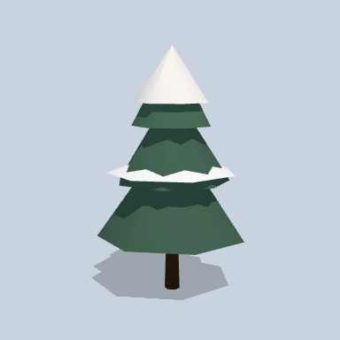 | **Pinheiro com neve**<br>[`pinheiro_com_neve.glb`](modelos/pinheiro_com_neve.glb) | Pinheiro com neve nas pontas dos galhos | 94 | 5,9 m × 9,7 m × 5,7 m | 13,6 KB |
| 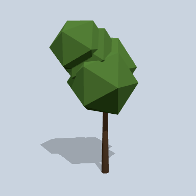 | **Árvore folhosa**<br>[`arvore_folhosa.glb`](modelos/arvore_folhosa.glb) | Árvore de copa redonda de 8 m | 104 | 4,1 m × 8,1 m × 4,1 m | 14,9 KB |
|  | **Árvore folhosa grande**<br>[`arvore_folhosa_grande.glb`](modelos/arvore_folhosa_grande.glb) | Árvore de copa larga de 9 m | 104 | 6,1 m × 8,4 m × 4,3 m | 14,9 KB |
| 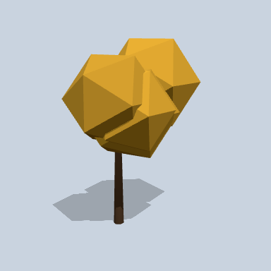 | **Ipê amarelo**<br>[`ipe_amarelo.glb`](modelos/ipe_amarelo.glb) | Árvore florida de copa amarela | 104 | 3,5 m × 7,3 m × 5,6 m | 14,9 KB |
|  | **Árvore tropical**<br>[`arvore_tropical.glb`](modelos/arvore_tropical.glb) | Árvore alta de copa verde-escura, 12 m | 104 | 6,9 m × 11,8 m × 6,5 m | 14,9 KB |
|  | **Palmeira**<br>[`palmeira_de_praia.glb`](modelos/palmeira_de_praia.glb) | Palmeira de tronco em gomos e leque de folhas | 308 | 6,0 m × 8,7 m × 5,9 m | 41,2 KB |
| 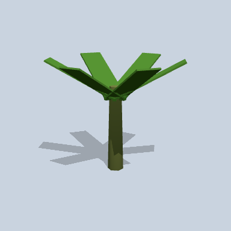 | **Bananeira**<br>[`bananeira.glb`](modelos/bananeira.glb) | Bananeira de seis folhas | 96 | 3,9 m × 3,4 m × 4,1 m | 13,8 KB |
| 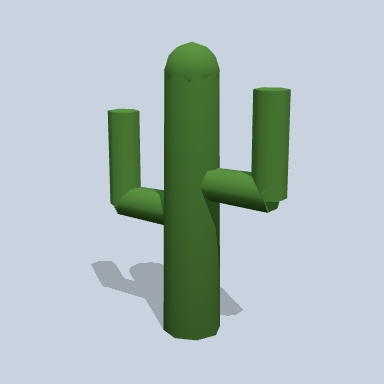 | **Cacto**<br>[`cacto.glb`](modelos/cacto.glb) | Cacto de braços (deserto) | 208 | 2,4 m × 3,5 m × 72 cm | 28,2 KB |
|  | **Árvore seca**<br>[`arvore_seca.glb`](modelos/arvore_seca.glb) | Tronco seco com galhos sem folhas | 44 | 2,5 m × 4,8 m × 1,6 m | 7,2 KB |

## Arbustos, capim e pedras

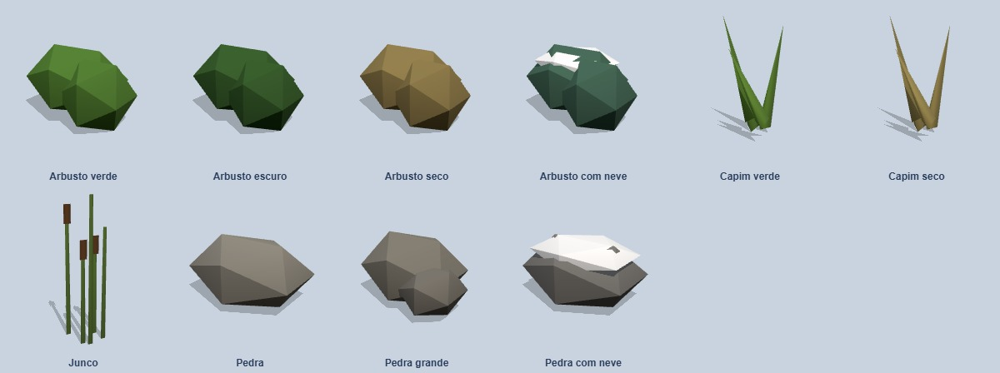

O miúdo da beira de estrada e da beira d'água. O capim tem 12 triângulos: dá para espalhar aos milhares.

| Prévia | Modelo | Descrição | Triângulos | Medidas | Tamanho |
|---|---|---|---|---|---|
| 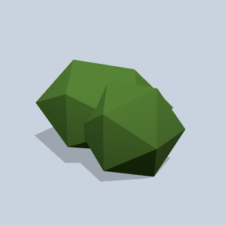 | **Arbusto verde**<br>[`arbusto_verde.glb`](modelos/arbusto_verde.glb) | Moita arredondada | 40 | 1,9 m × 1,2 m × 1,5 m | 6,7 KB |
| 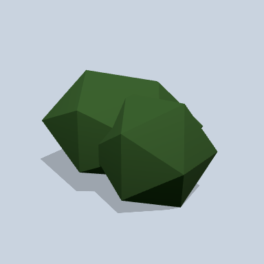 | **Arbusto escuro**<br>[`arbusto_escuro.glb`](modelos/arbusto_escuro.glb) | Moita verde-escura | 40 | 1,9 m × 1,2 m × 1,5 m | 6,7 KB |
| 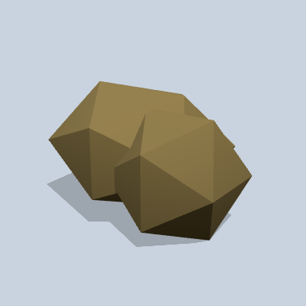 | **Arbusto seco**<br>[`arbusto_seco.glb`](modelos/arbusto_seco.glb) | Moita seca de cerrado e deserto | 40 | 1,9 m × 1,2 m × 1,5 m | 6,7 KB |
| 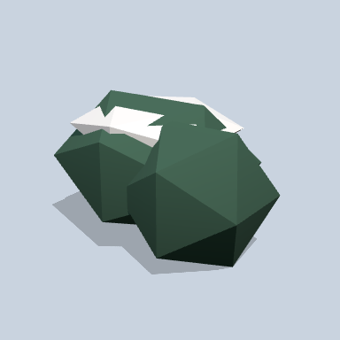 | **Arbusto com neve**<br>[`arbusto_com_neve.glb`](modelos/arbusto_com_neve.glb) | Moita com neve por cima | 60 | 1,9 m × 1,2 m × 1,5 m | 9,3 KB |
| 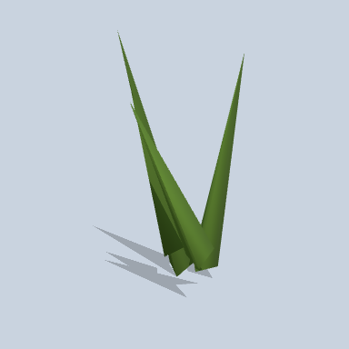 | **Capim verde**<br>[`capim_verde.glb`](modelos/capim_verde.glb) | Touceira de capim (12 triângulos) | 12 | 39 cm × 1,1 m × 55 cm | 3,1 KB |
|  | **Capim seco**<br>[`capim_seco.glb`](modelos/capim_seco.glb) | Touceira de capim seco | 12 | 39 cm × 1,1 m × 55 cm | 3,1 KB |
|  | **Junco**<br>[`junco.glb`](modelos/junco.glb) | Juncos de beira d'água com as espigas | 48 | 48 cm × 1,7 m × 36 cm | 7,7 KB |
| 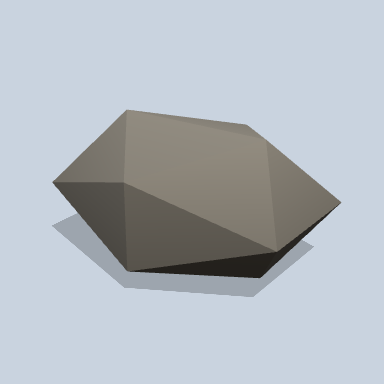 | **Pedra**<br>[`pedra.glb`](modelos/pedra.glb) | Pedra achatada | 20 | 1,8 m × 95 cm × 1,4 m | 4,1 KB |
| 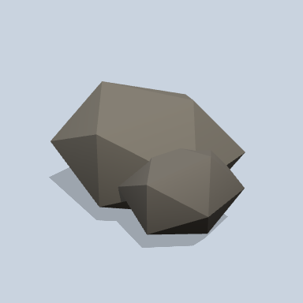 | **Pedra grande**<br>[`pedra_grande.glb`](modelos/pedra_grande.glb) | Duas rochas grandes juntas | 40 | 4,6 m × 2,7 m × 3,7 m | 6,7 KB |
| 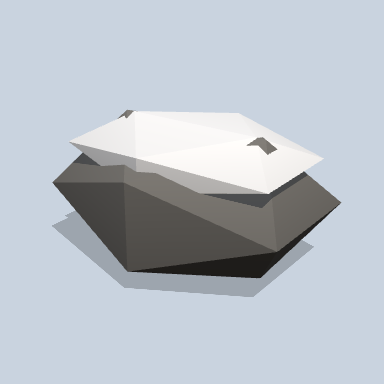 | **Pedra com neve**<br>[`pedra_com_neve.glb`](modelos/pedra_com_neve.glb) | Pedra com neve por cima | 40 | 1,8 m × 96 cm × 1,4 m | 6,7 KB |

## Sítio e beira de estrada


As construções dos sítios do mundo aberto e as placas que avisam das pontes estreitas e dos vaus. As casinhas e o celeiro têm uma fundação de pedra que desce abaixo do chão, para assentar em terreno irregular.

| Prévia | Modelo | Descrição | Triângulos | Medidas | Tamanho |
|---|---|---|---|---|---|
| 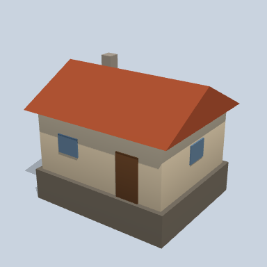 | **Casinha de sítio**<br>[`casinha_de_sitio.glb`](modelos/casinha_de_sitio.glb) | Casa de sítio com telhado de duas águas e chaminé | 92 | 6,8 m × 5,8 m × 5,8 m | 13,3 KB |
|  | **Casinha azul**<br>[`casinha_azul.glb`](modelos/casinha_azul.glb) | A mesma casinha em azul | 92 | 6,8 m × 5,8 m × 5,8 m | 13,3 KB |
|  | **Celeiro**<br>[`celeiro.glb`](modelos/celeiro.glb) | Celeiro vermelho de madeira com telhado de chapa | 112 | 10,6 m × 8,4 m × 8,8 m | 21,6 KB |
| 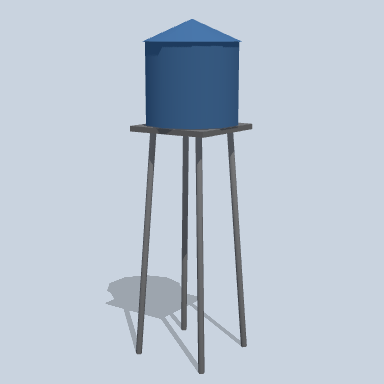 | **Caixa-d'água**<br>[`caixa_dagua.glb`](modelos/caixa_dagua.glb) | Caixa-d'água azul sobre torre de quatro pés | 112 | 2,6 m × 9,4 m × 2,8 m | 15,9 KB |
| 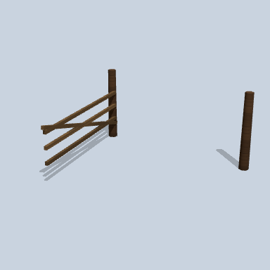 | **Porteira**<br>[`porteira.glb`](modelos/porteira.glb) | Porteira de madeira aberta entre dois mourões | 96 | 4,8 m × 2,2 m × 4,2 m | 16,7 KB |
|  | **Poste de luz de madeira**<br>[`poste_de_madeira.glb`](modelos/poste_de_madeira.glb) | Poste rural com cruzeta e isoladores | 96 | 1,8 m × 8,6 m × 30 cm | 17,9 KB |
| 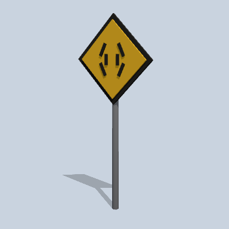 | **Placa de ponte estreita**<br>[`placa_ponte_estreita.glb`](modelos/placa_ponte_estreita.glb) | Placa de advertência em losango: ponte estreita | 120 | 1,3 m × 2,9 m × 14 cm | 16,9 KB |
|  | **Placa de vau**<br>[`placa_vau.glb`](modelos/placa_vau.glb) | Placa de advertência em losango: pista alagada (vau) | 168 | 1,3 m × 2,9 m × 14 cm | 23,1 KB |

## Estrada, pontes e represa


Pórticos de largada e chegada dos estágios (a estrada passa entre as torres, em Z), pontes desenhadas sobre uma estrada reta (o piso da pista não vem junto: o tabuleiro fica 3 cm abaixo dela, com a origem na altura da pista e os pilares descendo até o leito do rio) e a barragem de concreto com a casa de controle.

| Prévia | Modelo | Descrição | Triângulos | Medidas | Tamanho |
|---|---|---|---|---|---|
| 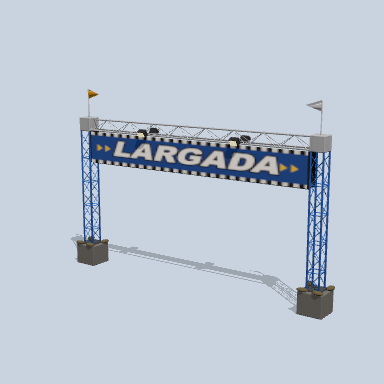 | **Pórtico de largada**<br>[`portico_de_largada.glb`](modelos/portico_de_largada.glb) | Pórtico de treliça azul com faixa LARGADA, refletores e bandeirinhas (estrada de 10,4 m) | 3.060 | 11,5 m × 7,3 m × 1,1 m | 425,6 KB |
|  | **Pórtico de chegada**<br>[`portico_de_chegada.glb`](modelos/portico_de_chegada.glb) | Pórtico de treliça vermelho com faixa CHEGADA | 3.060 | 11,5 m × 7,3 m × 1,1 m | 426,6 KB |
|  | **Ponte de concreto**<br>[`ponte_de_concreto.glb`](modelos/ponte_de_concreto.glb) | Ponte de 28 m: tabuleiro, muretas, pilares e cabeceiras (pista de 8,4 m) | 552 | 10,0 m × 6,7 m × 32,2 m | 72,6 KB |
|  | **Ponte de madeira**<br>[`ponte_de_madeira.glb`](modelos/ponte_de_madeira.glb) | Ponte de 20 m: tábuas, guarda-corpo de madeira, pilares roliços (pista de 6,4 m) | 792 | 8,0 m × 6,5 m × 24,2 m | 107,5 KB |
|  | **Barragem**<br>[`barragem.glb`](modelos/barragem.glb) | Barragem de concreto de 36 m com mureta e casa de controle | 56 | 36,0 m × 11,5 m × 7,3 m | 8,5 KB |

## Pastas

- `modelos/<id>.glb`: um modelo por arquivo.
- `texturas/`: as 4 texturas de 64×64 px do kit (as mesmas que vão dentro dos `.glb`; as placas com texto ficam só dentro dos modelos).
- `previas/<id>.png`: vista três-quartos de cada modelo.
- `catalogo.json`: seções, modelos, descrições, medidas, triângulos, materiais e caminhos dos arquivos.
- `docs/`: mosaico geral, mosaicos por seção e a capa.

## Como usar os modelos

- Metros, eixo Y para cima, frente em +Z. A origem fica no chão, no pé da árvore, no centro da construção ou no eixo da estrada (pórticos e pontes).
- As cores estão na cor por vértice (com a base escurecida perto do chão, como luz ambiente assada); as texturas são cinza e só dão o grão. Ligue a cor por vértice no material se o seu programa não ligar sozinho.
- Para florestas grandes, desenhe cada modelo com instâncias (uma chamada de desenho por modelo) e varie giro e escala (0,8 a 1,3) por cópia.
- Os pórticos têm a faixa com texto em português (LARGADA e CHEGADA) no material `placa`: troque a textura para traduzir.

Exemplo em JavaScript, com o carregador de glTF da sua biblioteca web 3D:

```js
const pinheiro = (await carregadorGltf.loadAsync("modelos/pinheiro.glb")).scene;
pinheiro.traverse((o) => { if (o.isMesh) o.material.vertexColors = true; });
for (let i = 0; i < 200; i++) {
  const p = pinheiro.clone();
  p.position.set(Math.random() * 400 - 200, 0, Math.random() * 400 - 200);
  p.rotation.y = Math.random() * Math.PI * 2;
  cena.add(p);
}
```

## Perguntas frequentes

**Em que formato estão os modelos?**
Em glTF 2.0 binário (`.glb`), um arquivo por modelo, com malha, materiais e texturas embutidos. As texturas do kit também estão soltas em PNG.

**Posso importar em qualquer motor de jogo ou programa 3D?**
Sim, em qualquer motor, biblioteca web ou editor 3D que leia glTF 2.0. A única extensão usada é a de material sem iluminação (luzes e placas), que todos os leitores de glTF conhecem.

**As pontes vêm com a estrada?**
Não: só o tabuleiro, os guarda-corpos, os pilares e as cabeceiras. No jogo a pista passa por cima, como uma fita; ponha a sua estrada na altura y = 0 do modelo.

**Posso usar num jogo comercial?**
Sim. Os modelos estão em domínio público (CC0 1.0): use, modifique e redistribua sem pedir licença nem dar crédito. O crédito é bem-vindo (veja [`CITATION.cff`](CITATION.cff)).

**Como foram feitos?**
Por código: cada modelo é montado a partir de poliedros, cilindros, cones, caixas e perfis extrudados, com cor por vértice e texturas de 64 px desenhadas em canvas, pelo mesmo código que desenha o mundo aberto e os estágios no jogo. Cada arquivo foi exportado, aberto de novo e desenhado para conferir.

## Outras coleções do mesmo jogo

- [Frota de carros de rali](https://github.com/kayquer/scitizia-frota-64) · [Props quebráveis](https://github.com/kayquer/scitizia-props-64) · [Pessoas](https://github.com/kayquer/scitizia-pessoas-64) · [Rodas e pneus](https://github.com/kayquer/scitizia-rodas-64) · [Peças de carro](https://github.com/kayquer/scitizia-pecas-64) · [Cidade](https://github.com/kayquer/scitizia-cidade-64)

## Licença

[CC0 1.0 Universal](LICENSE): domínio público.

## Como citar

Os metadados de citação estão em [`CITATION.cff`](CITATION.cff).
